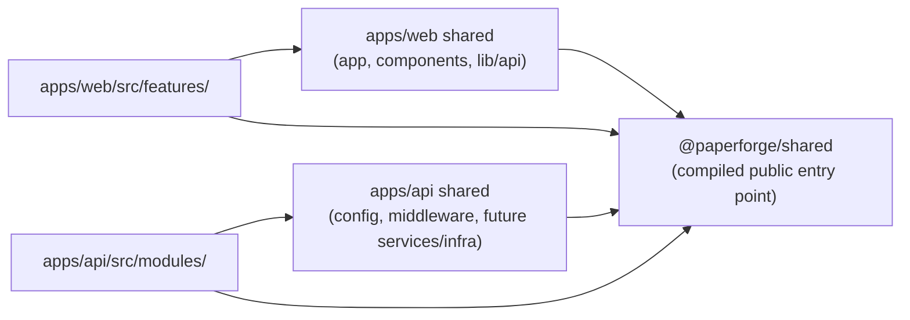

# Module Boundaries and Workspace Ownership

PaperForge is developed by four university team members working concurrently. Clear directory ownership and strict import boundaries allow all four modules to progress in parallel without creating merge conflicts or incompatible implementations.

## 1. Feature Module Ownership

| Module       | Name                                      | Owner                                                          | Frontend Directory (Implemented Placeholder) | Backend Directory (Reserved Placeholder) | Provisional Reserved API Namespace | Central Specification                                         |
| ------------ | ----------------------------------------- | -------------------------------------------------------------- | -------------------------------------------- | ---------------------------------------- | ---------------------------------- | ------------------------------------------------------------- |
| **Module 1** | Exam Question Paper Generator             | Module 1 Developer (also leads shared foundation coordination) | `apps/web/src/features/exam/`                | `apps/api/src/modules/exam/`             | `/api/v1/exams`                    | [01-exam-generator.md](../modules/01-exam-generator.md)       |
| **Module 2** | Interactive Source-Based Quiz Generator   | Module 2 Developer                                             | `apps/web/src/features/quiz/`                | `apps/api/src/modules/quiz/`             | `/api/v1/quizzes`                  | [02-quiz-generator.md](../modules/02-quiz-generator.md)       |
| **Module 3** | Unified Assessment Editor & Export Engine | Module 3 Developer                                             | `apps/web/src/features/editor/`              | `apps/api/src/modules/editor/`           | `/api/v1/assessments`              | [03-assessment-editor.md](../modules/03-assessment-editor.md) |
| **Module 4** | Modular Slide Deck Generator              | Module 4 Developer                                             | `apps/web/src/features/slides/`              | `apps/api/src/modules/slides/`           | `/api/v1/slides`                   | [04-slide-generator.md](../modules/04-slide-generator.md)     |

> **Current status**: Only placeholder React pages (`ExamPage.tsx`, `QuizPage.tsx`, `EditorPage.tsx`, `SlidesPage.tsx`) and backend module `README.md` boundary files exist today. The listed API namespaces are **provisional** placeholders until Phase 02 API contracts are approved; unimplemented `/api/v1/*` routes currently return the standard structured `404` JSON error envelope.

## 2. Shared Foundation Ownership

Shared foundation files are **centrally coordinated** by the Module 1 developer (foundation coordinator) with review from affected module developers before modification.

### Existing Shared Directories and Files (Implemented)

- **Repository root configuration**:
  - `package.json`, `pnpm-workspace.yaml`, `pnpm-lock.yaml`
  - `tsconfig.base.json`, `.node-version`, `.prettierrc.json`, `.prettierignore`, `.editorconfig`, `.gitattributes`, `.gitignore`
  - `AGENTS.md`, `README.md`, `CONTRIBUTING.md`, `docs/`
- **Shared contracts package**:
  - `packages/shared/` (`@paperforge/shared`) — compiled schemas and types exported from `packages/shared/src/index.ts` -> `packages/shared/dist/index.{js,d.ts}`
- **Shared frontend infrastructure (`apps/web`)**:
  - `apps/web/src/app/` — application root, declarative router (`router.tsx`), navigation registry (`navigation.ts`)
  - `apps/web/src/components/` — shared layout (`layout/`), UI primitives (`ui/`), and feedback components (`feedback/`)
  - `apps/web/src/lib/api/` — browser `fetch` API client (`client.ts`, `errors.ts`, `health.ts`)
  - `apps/web/src/pages/` — generic fallback pages (`NotFoundPage.tsx`)
  - `apps/web/src/styles/` — shared Tailwind CSS v4 tokens and global styling (`index.css`)
  - `apps/web/src/features/dashboard/` — shared landing dashboard and live backend health status
  - `apps/web/vite.config.ts`, `apps/web/vitest.config.ts`, `apps/web/tsconfig*.json`, `apps/web/package.json`
- **Shared backend infrastructure (`apps/api`)**:
  - `apps/api/src/app.ts` — Hono application factory and top-level route mounting
  - `apps/api/src/index.ts` — server lifecycle, startup modes, and graceful shutdown
  - `apps/api/src/config/` — Zod environment loading and validation (`env.ts`)
  - `apps/api/src/middleware/` — structured error handling (`errors.ts`) and compiled SPA static serving (`frontend.ts`)
  - `apps/api/src/routes/` — infrastructure routes (`health.ts`, `dev.ts`)
  - `apps/api/scripts/` — supervised backend dev runner (`dev.mjs`)
  - `apps/api/.env.example`, `apps/api/tsconfig*.json`, `apps/api/vitest.config.ts`, `apps/api/package.json`

### Proposed Future Shared Infrastructure Paths (Planned — Do Not Exist Yet)

The following paths are **planned architectural locations** for Phase 02+ and **do not currently exist** in the repository:

| Proposed Path (Planned)                             | Intended Shared Responsibility                                                                                                                                               | Consumers                                                        |
| --------------------------------------------------- | ---------------------------------------------------------------------------------------------------------------------------------------------------------------------------- | ---------------------------------------------------------------- |
| `apps/api/src/services/documents/` _(planned)_      | Common text-based PDF/DOCX/PPTX ingestion producing `SourceDocument`                                                                                                         | Modules 1, 2, 4                                                  |
| `apps/api/src/services/ai/` _(planned)_             | Single AI-provider abstraction (mock provider first, then evaluated Gemini provider)                                                                                         | Modules 1, 2, 4 (and optional future editor helpers if approved) |
| `apps/api/src/infrastructure/database/` _(planned)_ | SQLite persistence layer and repositories (driver/ORM selection pending)                                                                                                     | All modules                                                      |
| `apps/api/src/infrastructure/storage/` _(planned)_  | Private local file storage manager resolving safely inside repository-root `.data/`                                                                                          | Document ingestion, export artifacts                             |
| `.data/` _(planned runtime directory, gitignored)_  | Private local runtime storage for uploaded files, SQLite database files, and temporary exports (future `DATA_DIR` must resolve consistently relative to the repository root) | Backend runtime only (never statically served)                   |

> Do not create placeholder runtime directories or speculative implementations for these paths until their Phase 02 tasks are approved.

## 3. Dependency and Import Rules

### Mandatory Boundary Constraints

1. **Single public entry point for `@paperforge/shared`**:
   - Both `apps/web` and `apps/api` must import shared schemas and types exclusively from `"@paperforge/shared"`.
   - Never import from `packages/shared/src/*`, private `packages/shared/dist/*` subpaths, or custom TypeScript path aliases.
2. **Browser-safe shared package**:
   - `packages/shared` must remain runtime-independent. It must never import React, Hono, Node.js standard libraries (`node:fs`, `node:path`, etc.), browser globals, environment variables, database code, or AI SDKs.
3. **No cross-feature private imports**:
   - `apps/web/src/features/exam/` must not import internals from `features/quiz/`, `features/editor/`, or `features/slides/` (and vice versa).
   - `apps/api/src/modules/exam/` must not import internal helpers or private route handlers from `modules/quiz/`, `modules/editor/`, or `modules/slides/`.
   - Cross-module handoffs (such as Module 1 and Module 2 sending structured drafts to Module 3) must use approved contracts in `@paperforge/shared`, documented backend service interfaces, or persisted assessment records via shared infrastructure.
4. **No frontend access to backend internals or filesystem**:
   - `apps/web` must never import from `apps/api` or reference backend hostnames, ports, filesystem paths, `.data/`, or database internals.
   - All browser HTTP calls must go through `apps/web/src/lib/api/` using normalized relative `/api/...` paths.
5. **No duplicated shared capabilities**:
   - Individual modules must not add separate document parsers, separate AI provider clients, separate SQLite connections, separate error envelope formats, or competing assessment export pipelines.
6. **Private file containment**:
   - Uploaded documents, SQLite databases, and generated private files must remain outside `apps/web/dist` and any statically served directory.

## 4. Coordinating Shared Changes

Routine work inside a module's own feature/module directory (`apps/web/src/features/<module>/` and `apps/api/src/modules/<module>/`) can proceed independently on a module branch.

Changes to any **shared foundation** path require coordination before merging:

1. **Identify affected parties**:
   - Any change to `packages/shared` schemas or shared handoff models affects both producing and consuming modules (e.g., exam/quiz draft contracts affect Modules 1, 2, and 3; `SourceDocument` affects Modules 1, 2, and 4).
   - Any change to `apps/api/src/app.ts`, `apps/web/src/app/router.tsx`, shared UI primitives, shared API client, or root dependencies affects the entire team.
2. **Propose before implementing**:
   - Share the intended contract or interface change with the foundation coordinator (Module 1 developer) and every affected module owner before altering shared files.
3. **Verify across all workspaces**:
   - Run `pnpm typecheck`, `pnpm test`, `pnpm build`, and `pnpm format:check` after any shared change so no module is broken silently.

See [CONTRIBUTING.md](../../CONTRIBUTING.md) for the full team branching and integration workflow.
