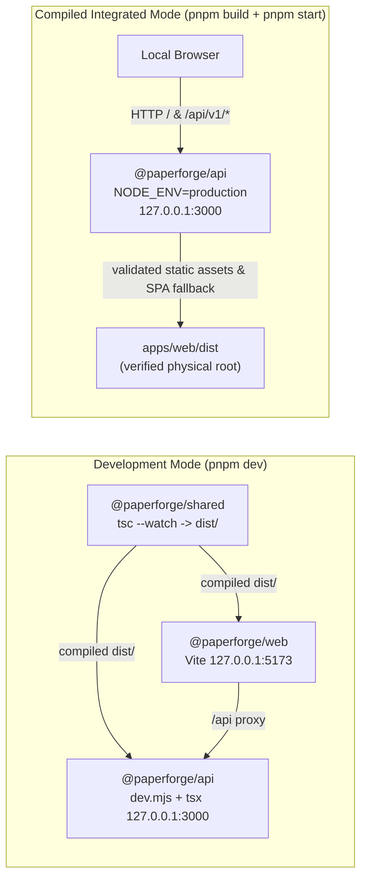
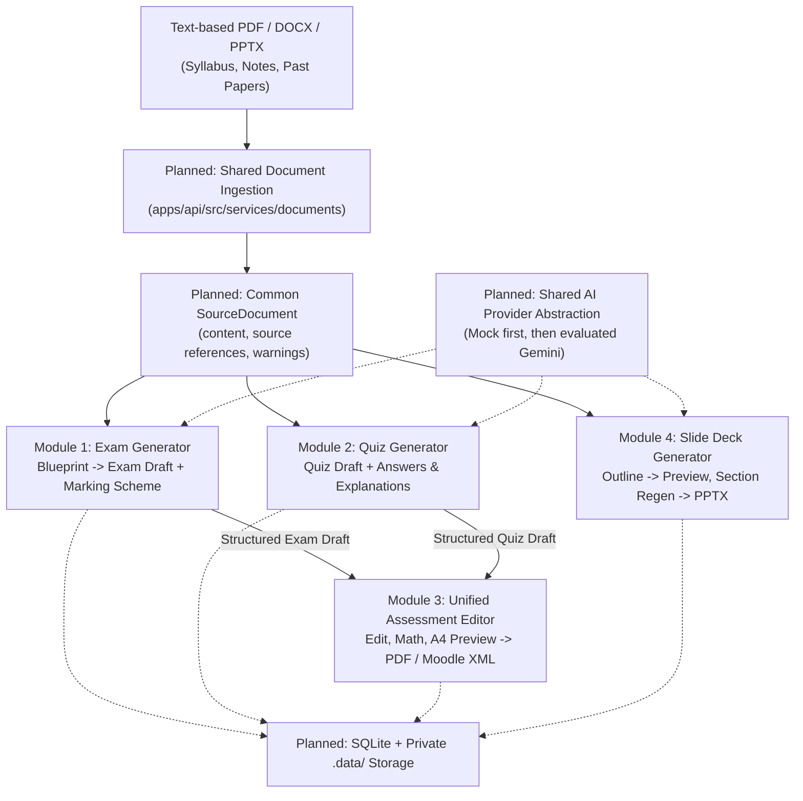

# PaperForge Architecture Overview

This document explains PaperForge's repository structure, runtime execution modes, shared infrastructure responsibilities, and conceptual data flow across its four educational modules. It explicitly distinguishes **implemented foundation capabilities (PF-01.5)** from **planned Phase 02+ capabilities**.

## 1. Architectural Style: Modular Monolith in a TypeScript Monorepo

PaperForge is built as a **modular monolith** inside a single `pnpm` TypeScript monorepo rather than four separate applications or microservices.

### Why a Modular Monolith?

- **Shared educator workflow**: Educators move seamlessly from source ingestion to examination or quiz generation (Modules 1 and 2) into a unified assessment editor and exporter (Module 3), or into modular slide generation (Module 4). One application shell and one backend runtime eliminate cross-service auth, deployment, and routing friction.
- **Single source of truth for contracts**: TypeScript types and Zod runtime validation schemas live in `@paperforge/shared` and are consumed by both the frontend and backend, preventing schema drift across four student developers.
- **One shared infrastructure layer**: Document ingestion, AI provider integration, SQLite persistence, and private local file storage are centralized so modules do not build four incompatible parsers, databases, or AI clients.
- **Right-sized for a four-developer local prototype**: Running one frontend dev server and one backend process keeps local setup, testing, debugging, and grading demonstrations deterministic and lightweight.

### Why Three Workspaces Instead of Four Module Applications?

The repository is organized by **runtime layer** (`apps/web`, `apps/api`, `packages/shared`) rather than by individual module repositories, while enforcing **feature-level ownership boundaries** inside `apps/web/src/features/*` and `apps/api/src/modules/*`:

| Workspace         | Package Name         | Runtime Target          | Responsibility                                                                                                                                                  |
| ----------------- | -------------------- | ----------------------- | --------------------------------------------------------------------------------------------------------------------------------------------------------------- |
| `apps/web`        | `@paperforge/web`    | Browser (React + Vite)  | Shared application shell, dashboard, UI/feedback primitives, browser API client, and the four feature UIs (`exam`, `quiz`, `editor`, `slides`)                  |
| `apps/api`        | `@paperforge/api`    | Node.js 24 LTS (Hono)   | HTTP server, environment validation, centralized error handling, compiled SPA serving, and future shared backend services plus the four backend feature modules |
| `packages/shared` | `@paperforge/shared` | Runtime-independent ESM | Compiled shared TypeScript types and Zod schemas exported through a single public entry point (`dist/index.js` and `dist/index.d.ts`)                           |

Separating by runtime layer keeps browser code strictly isolated from Node.js APIs, filesystem access, and future secrets, while keeping all four modules in one coordinated application shell and HTTP API. See [ADR-0001](./decisions/0001-modular-monolith.md) and [Module Boundaries](./module-boundaries.md).

## 2. Current vs. Planned Architecture

### Currently Implemented (PF-01.5 Foundation)

- **Shared contracts (`packages/shared`)**: Infrastructure-level Zod schemas and inferred TypeScript types (`HealthResponseSchema`, `EchoRequestSchema`, `EchoResponseSchema`, `ApiErrorCodeSchema`, `ApiErrorResponseSchema`).
- **Frontend (`apps/web`)**:
  - React Router Declarative Mode shell (`/` dashboard plus placeholder routes `/exam`, `/quiz`, `/editor`, `/slides`, and fallback `*` not-found page).
  - Accessible navigation shell (`AppShell`, `Sidebar`, `AppHeader`, `PageHeader`) and minimal PaperForge-owned UI and feedback primitives (`Badge`, `Button`, `Card`, `Input`, `EmptyState`, `ErrorBoundary`, `ErrorState`, `LoadingState`).
  - Browser-native `fetch` API client (`apps/web/src/lib/api/`) enforcing normalized same-origin `/api` paths, `redirect: "error"`, timeout/abort handling, and runtime Zod validation of responses.
  - Dashboard live backend liveness indicator (`GET /api/v1/health`) with 5-second timeout and manual retry.
- **Backend (`apps/api`)**:
  - Hono application with `@hono/node-server` binding to loopback `127.0.0.1` (non-loopback `HOST` values are rejected).
  - Zod-validated environment configuration (`HOST`, `PORT`, `NODE_ENV`) loading optional `apps/api/.env` via native `process.loadEnvFile`.
  - `GET /api/v1/health` (all environments) and `POST /api/v1/dev/echo` (non-production only, RFC 9110 `content-type` validation).
  - Centralized structured JSON error handling (`errorHandler`, `notFoundHandler`) with sanitized error envelopes and validated header preservation (`WWW-Authenticate`, `Allow`, `Retry-After`).
  - Integrated compiled frontend serving (`apps/api/src/middleware/frontend.ts`) with physical build-root verification, symlink/junction rejection, per-request regular-file containment, and RFC 9110 SPA `Accept` negotiation. _(Core behavior is implemented and covered by automated tests; remaining platform-specific filesystem-link tests are pending PF-01.7/PF-01.8.)_
  - Development process supervisor (`apps/api/scripts/dev.mjs`) running Node.js with the `tsx` loader, verifying child IPC readiness and restarting on `apps/api/src` or `packages/shared/dist` changes. _(Final interactive native Windows shutdown and real-browser regression checks remain pending PF-01.7/PF-01.8.)_
- **Verification**: 301 automated foundation tests across 10 Vitest files (60 shared, 180 API, 61 web).

### Planned for Phase 02+ (Not Yet Implemented)

- Educational domain contracts in `@paperforge/shared` (`SourceDocument`, examination blueprint and draft schemas, quiz draft schemas, unified assessment editor model, slide deck model).
- Shared backend document-ingestion service (`PDF`/`DOCX`/`PPTX` text extraction producing a common `SourceDocument`).
- Shared backend AI-provider abstraction (deterministic mock provider first, followed by controlled evaluation of eligible Gemini API free-tier models).
- SQLite local persistence (driver and ORM selection pending) and private local file storage under repository-root `.data/`.
- Module 1–4 educational APIs, frontend authoring workflows, and export engines (PDF, Moodle XML, optional DOCX, PPTX).
- ESLint, unified `pnpm check` gate, and CI workflow (PF-01.7).

## 3. Execution Modes

PaperForge supports two primary integrated run modes plus two standalone modes:

1. **Integrated Development (`pnpm dev`)**:
   - First compiles `@paperforge/shared` so `packages/shared/dist/` exists before dependent processes start.
   - Runs three coordinated processes via `concurrently --kill-others`: `@paperforge/shared` (`tsc --watch`), `@paperforge/api` (`apps/api/scripts/dev.mjs` on `http://127.0.0.1:3000`), and `@paperforge/web` (Vite on `http://127.0.0.1:5173`, proxying `/api` to `http://127.0.0.1:3000`).
   - Browser code always requests relative `/api/...` paths so no backend host or port is hardcoded in frontend code.
2. **Compiled Integrated Local Server (`pnpm build` then `pnpm start`)**:
   - Compiles workspaces in dependency order (`@paperforge/shared` -> `@paperforge/api` -> `@paperforge/web`).
   - Starts `apps/api/dist/index.js --integrated` on `http://127.0.0.1:3000` with `NODE_ENV=production`, serving both `/api/v1/*` and compiled frontend assets from `apps/web/dist` while disabling `POST /api/v1/dev/echo`.
3. **Standalone Modes**:
   - `pnpm start:api`: Runs compiled `apps/api/dist/index.js` without static frontend serving (ordinary environment precedence).
   - `pnpm preview:web`: Starts Vite preview serving compiled `apps/web/dist` at `http://127.0.0.1:4173` for local build inspection (not production deployment). It does not start the backend automatically, but Vite `8.3.8` inherits the configured `/api` proxy to `http://127.0.0.1:3000` ([Vite `preview.proxy`](https://vite.dev/config/preview-options#preview-proxy)): the dashboard can display `Backend connected` when a separately running API returns a valid health response, or its disconnected/error state when the backend is unavailable.

See [Development Setup](../development/setup.md) for exact commands, environment precedence, and troubleshooting.

## 4. Planned Conceptual Data Flow Across Modules

The diagram below depicts the **planned** Phase 02+ educational data flow. None of these educational pipelines are implemented in PF-01.5.

### Key Architectural Integration Rules

- **One common source boundary**: Modules 1, 2, and 4 consume a shared `SourceDocument` representation rather than parsing raw uploaded files independently. See [ADR-0005](./decisions/0005-document-ingestion-scope.md).
- **One shared AI layer**: Modules 1, 2, and 4 call a centrally managed AI-provider abstraction with runtime Zod validation of outputs. See [ADR-0006](./decisions/0006-ai-provider-strategy.md).
- **Assessment convergence in Module 3**: Modules 1 and 2 transfer structured assessment drafts into Module 3 for unified editing, A4 preview, and assessment export (PDF, Moodle XML, optional DOCX). Module 3 does not edit slide decks.
- **Self-contained slide authoring in Module 4**: Module 4 owns slide outline generation, browser preview, section-level regeneration of PaperForge-created decks, and PPTX export from a single saved slide representation.
- **Educator review before finalization**: All AI-generated exams, marking schemes, quizzes, and slides remain editable drafts subject to educator review before export or classroom use (without assuming a separate mandatory approval-state mechanism).

## 5. Related Documentation

- [Module Boundaries & Ownership](./module-boundaries.md)
- [Architecture Decision Records](./decisions/0001-modular-monolith.md)
- [System Requirements](../requirements/system-requirements.md)
- [Requirements Traceability](../requirements/traceability.md)
- [Development Setup](../development/setup.md)
- [Project Roadmap](../roadmap.md)
